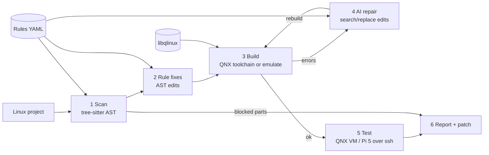

# How qpa works

`qpa port` never touches the original project. It copies it to `<out>/src`, works there, and writes `qnx-port.patch` (original → final, ready for `git apply`), `report.html`, `report.json`, `port.json`, build logs in `logs/` and every AI prompt and reply in `ai/`.

## 1. Scan (`qpa/scanner.py`)

C and C++ files are parsed with tree-sitter. Matching on the syntax tree instead of text gives:

- no matches in comments or string contents;
- launched commands only where a process is really started: `system()`, `popen()`, `exec*()`, a `NULL`-terminated argv array that is passed to a launcher, or a `run("parted", ...)` style wrapper (marked *likely*);
- `#include "linux/Compat.h"` that is the project's own file is not mistaken for a kernel header;
- **guards**: code inside `#ifdef __linux__`, behind a configure/CMake check (`HAVE_SCHED_SETAFFINITY`, `WITH_EPOLL`) or behind a test for the very name it uses (`#ifdef TCP_USER_TIMEOUT`) is marked as guarded. On QNX the check fails and the other branch is built, so it needs no rewrite.

Rules live in `qpa/rules/linux_api.yaml` (APIs, headers, `/proc` and `/sys` paths, types) and `qpa/rules/commands.yaml` (launched commands). Each rule has a level, a fix type, its QNX replacement and a confidence; `verified_on` records rules proven by a real QNX build.

## 2. Rule fixes (`qpa/fix.py`, `RuleFixer`)

Changes that are always the same are made as syntax-tree edits, never inside a guarded branch or a preprocessor condition:

| Linux | QNX 8.0 |
| --- | --- |
| `statfs` / `fstatfs` / `struct statfs` / `<sys/vfs.h>` | `statvfs` / `fstatvfs` / `struct statvfs` / `<sys/statvfs.h>` |
| `CLOCK_BOOTTIME`, `CLOCK_MONOTONIC_RAW`, `*_COARSE` | `CLOCK_MONOTONIC` / `CLOCK_REALTIME` |
| `prctl(PR_SET_NAME, n)` / `prctl(PR_GET_NAME, b)` | `pthread_setname_np(pthread_self(), n)` / `pthread_getname_np(...)` |

## 3. Build (`qpa/target.py`, `qpa/build.py`)

Every target is driven through generated compiler wrappers (`<src>/.qpa/bin/cc`, `c++`). A wrapper works with any build system (CMake, Autotools, plain make, custom commands) without editing it. It adds the libqlinux headers and, when linking, the libqlinux archive.

| Target | Compiler | Use |
| --- | --- | --- |
| `qnx-x86_64`, `qnx-aarch64le` | `ntox86_64-gcc` / `ntoaarch64-gcc` (or `qcc -V…`) from QNX SDP 8.0 | the real port; CMake gets a generated QNX toolchain file, Autotools `--host=<arch>-…-nto-qnx8.0.0` |
| `emulate` | host gcc | a fast check without the SDP; see below |

On a QNX target, qpa first **probes** the toolchain (`accept4`, `pipe2`, `dup3`). libqlinux replacements are only mapped for calls that are missing.

**The emulate target** removes from a Linux build what QNX 8.0 does not have:

- Linux-only headers that the project names (and a fixed set such as `sys/epoll.h`, `sys/sysinfo.h`) become `#error` stubs. Headers that the host libc includes for itself (`linux/types.h`, `asm/…`) are detected with `cc -M` and left alone.
- Linux-only functions are refused at link time with `ld --wrap=<fn>` and no wrapper. The link error is traced back to the calling lines, so the repair loop gets `file:line`.
- `__linux__` is undefined, so code and configure/CMake checks take the non-Linux path.
- Nothing is pre-included, so the project's own `_GNU_SOURCE` / `_XOPEN_SOURCE` settings behave as in a normal build. An earlier design that pre-included headers broke hiredis, which builds with `-Werror` and needs the XSI `strerror_r`.

Configure steps run with `QPA_PHASE=configure` so feature checks (`char socket(); socket();`) see a clean compiler.

Errors are parsed from GCC/ld output. A stub's `#error` is reported at the project's `#include` line, and duplicates are collapsed. `make -k` / `cmake --build -- -k` keep building past the first failing file so every error is seen at once.

## 4. AI repair (`qpa/fix.py`, `ai_repair`; `qpa/llm.py`)

For each round, qpa sends the model:

- the compiler errors, at most 12, with `file:line`;
- the code around each error;
- the porting notes from the rules for those files;
- what was tried before and why it was reverted.

The model answers with JSON search/replace edits. A search text must occur exactly once in its file. The model is told to keep the Linux path behind `#ifdef __linux__`, so the patch can go upstream. QNX-only APIs (`ThreadCtl`) go behind `#ifdef __QNX__`. The model must not rewrite what libqlinux already provides.

**The compiler is the referee.** An edit is kept only if the next build passes, has fewer errors, or clears the first error without adding any. Otherwise every file in that round is restored. Providers are the Anthropic Messages API, any OpenAI-compatible endpoint (`QPA_API_BASE` for a gateway or a local model) and `replay`, which plays back recorded responses for tests. Only the standard library is used.

## 5. Test (`qpa/runner.py`, `qpa/vm.py`)

`test.files` from `qpa.yaml` are staged and copied with `scp` to `/tmp/qpa/<project>` on the device, and `test.command` is run there over `ssh`. `qpa vm up` builds and boots a headless QNX 8.0 QEMU image with the SDP's `mkqnximage --type=qemu --run=-h`, installs a generated ssh key, and prints the `QPA_DEVICE` to use. On `emulate` the test command runs on the host.

## 6. libqlinux

| Linux | Emulation |
| --- | --- |
| epoll | `poll()`; the epoll fd is a pipe whose read end is handed out and which wakes a blocked `epoll_wait()` when `epoll_ctl()` changes the set; closed fds are dropped as on Linux; `EPOLLONESHOT`; round-robin fairness |
| eventfd | an anonymous FIFO opened read-write: one fd you can read, write, poll and close; semaphore and counter modes |
| accept4 / pipe2 / dup3 / `SOCK_*` | the plain call + `fcntl()`, mapped only where the target lacks them; a header-free force-include mode keeps the program's feature macros intact |

The libqlinux tests (77 checks) run under ASan, UBSan and TSan in CI. mosquitto's event loop runs on `qlinux_epoll_*` in the benchmark, and its publish/subscribe test passes.
